# Nâng cấp nhận diện bộ phận chai — đề xuất triển khai

**Cập nhật triển khai:** xem [IMPLEMENTATION.md](IMPLEMENTATION.md). Bản đề xuất dưới đây là thiết kế ban đầu; code hiện tại dùng API v1 mở rộng và material baseline ResNet18 cho CPU. Chưa bật checkpoint bộ phận đã kiểm chứng trong ứng dụng.

Tài liệu thiết kế cho dự án hiện tại, ngày 03/11/2026. Chưa thay checkpoint, chưa huấn luyện và chưa bật tính năng nhận diện bộ phận trong ứng dụng đang chạy.

## Phạm vi và kết quả mong muốn

Nhận biết riêng nắp (`cap`), thân/vỏ (`body`), nhãn dán (`label`), sau đó dự đoán vật liệu của từng bộ phận. Một lượt có thể chứa nhiều chai; mỗi bộ phận cần gắn với đúng chai. Nhãn dán và thân có thể chồng lấp trong ảnh.

Ví dụ kết quả mong muốn: một chai có thân thủy tinh, nắp kim loại, nhãn giấy. Đây là ví dụ nghiệp vụ, không phải kết luận vật liệu cho ảnh người dùng đã gửi. Vật liệu nhãn in/ép màng có thể khó phân biệt bằng ảnh; phần không đủ bằng chứng phải trả `unknown` hoặc yêu cầu xác nhận.

## Vì sao pipeline hiện tại chưa làm được

- `trashsmart/pipeline/main.py::process_image` dùng YOLO để tìm chai, cắt toàn chai rồi gọi `get_class_labels_batch` bằng ResNet. Không có bước tìm nắp/thân/nhãn.
- `trashsmart/shared/classes.py` quy định bốn lớp vật liệu: glass, metal, paper, plastic. Các lớp đó không mô tả vị trí/bộ phận.
- `Detection`, `YoloPredictResponseDTO`, `AiResponseDetailsDTO` và `ScanService` đang biểu diễn mỗi chai như một detection phẳng, chưa có danh sách thành phần.
- `FE/assets/app.js::resultMarkup` vẽ một thẻ cho mỗi detection và một kết quả vật liệu. Đổi nội dung thẻ không bổ sung được khả năng nhìn thấy bộ phận.

Không được suy ra nắp/nhãn bằng cách sao chép vật liệu hoặc điểm confidence của cả chai. Việc đổi tên lớp trong config hoặc thêm ba chuỗi tên bộ phận cũng không huấn luyện ra bộ phát hiện mới.

## Kiến trúc AI đề xuất, giữ hướng YOLO + ResNet

```mermaid
flowchart LR
    A[Ảnh đầu vào] --> B[YOLO hiện có: tìm từng chai]
    B --> C[Cắt vùng từng chai]
    C --> D[YOLO bộ phận mới: cap, body, label]
    D --> E[Cắt vùng từng bộ phận]
    E --> F[ResNet vật liệu được fine-tune trên ảnh bộ phận]
    F --> G[Gom theo chai: vị trí, bộ phận, vật liệu, confidence]
    G --> H[BE lưu cây kết quả và model version]
    H --> I[FE hiển thị chai và các bộ phận]
```

YOLO hiện tại vẫn có thể dùng làm bộ định vị chai nếu đánh giá trên ảnh triển khai đạt yêu cầu. Huấn luyện thêm một YOLO cho ba lớp bộ phận. Fine-tune một ResNet riêng cho ảnh crop bộ phận; có thể dùng backbone pretrained hoặc trọng số cũ để khởi tạo, nhưng không dùng nguyên checkpoint phân loại toàn chai rồi coi là đã biết phân loại nắp/nhãn.

Bắt đầu bằng bounding box để gán nhãn nhanh và phù hợp với pipeline crop hiện có. Nếu cần đường viền sát nắp/nhãn và tách vùng chồng lấp chính xác hơn, chuyển mô hình bộ phận sang instance segmentation và dùng polygon/mask được gán nhãn tương ứng. Detection và segmentation có định dạng annotation khác nhau, cần chuẩn bị đúng task: [Ultralytics detection datasets](https://docs.ultralytics.com/datasets/detect/), [segmentation datasets](https://docs.ultralytics.com/datasets/segment/).

Đối với model bộ phận, dùng NMS có xét lớp để không loại các bộ phận khác loại đang chồng lấp; không sao chép nguyên cờ class-agnostic của bộ định vị chai. Tọa độ từ crop phải đổi về ảnh gốc. Nếu vùng chai chồng lấp nhau, cần kiểm tra/gỡ trùng và gắn mỗi bộ phận với đúng parent, thay vì gán mù cùng một nắp cho hai chai.

Không ghi đè `best_new.pt` hoặc các checkpoint đang phục vụ V1. Dùng tên/path riêng cho `PARTS_YOLO_MODEL_PATH`, `PARTS_RESNET_MODEL_PATH`, và cờ `PARTS_ENABLED`. Checkpoint vật liệu cần metadata cho biết đã huấn luyện trên bộ phận, kèm thứ tự lớp và phiên bản. `/metadata` và `/health` cần phân biệt model chai sẵn sàng với model bộ phận sẵn sàng.

## Dữ liệu cần chuẩn bị trước khi huấn luyện

Mỗi ảnh cần box chai, các box bộ phận nhìn thấy, bộ phận thuộc chai nào và vật liệu đã được xác minh. Có thể tận dụng ảnh chai hiện có để gán nhãn bổ sung nếu nắp và nhãn đủ rõ.

- Các bộ phận: cap, body, label. Một chai có thể có nhiều nhãn, không bắt buộc đúng một nhãn/chai.
- Vật liệu: glass, metal, paper, plastic. Cho phép chưa biết vật liệu; không ép đoán theo màu sắc hoặc thương hiệu.
- Ảnh có nắp nhựa/nắp kim loại, nhãn giấy/nhãn nhựa, chai không nắp, không nhãn, bị che, bị bóp méo, ánh sáng khác nhau, nhiều chai và nền khó.
- Ảnh không nhìn thấy nắp không được tự gán một box nắp tưởng tượng. Không phát hiện được cũng không có nghĩa là bộ phận không tồn tại.
- Các mẫu chưa xác minh vật liệu có thể dùng cho task định vị bộ phận; chưa dùng làm nhãn giám sát cho bộ phân loại vật liệu. `unknown` ở inference là cơ chế từ chối khi chưa đủ tin cậy, không mặc nhiên là một lớp đã có dữ liệu huấn luyện.
- Chia tập theo chai/sản phẩm hoặc phiên chụp để các ảnh rất giống nhau không lọt sang cả train và test. Giữ riêng tập test nhiều loại sản phẩm/nền khác với train.

`annotation.example.json` mô tả metadata cần giữ. Đây là mẫu minh họa, không phải dữ liệu huấn luyện có ảnh đi kèm. Có thể xuất box bộ phận thành YOLO detect và sinh crop vật liệu theo thư mục từ cùng metadata. Định dạng YOLO detect cần class và box cho từng object; xem [hướng dẫn chuẩn bị dữ liệu của Ultralytics](https://academy.ultralytics.com/courses/train-your-first-yolo/prepare-a-dataset).

Không cam kết độ chính xác theo số ảnh hoặc số epoch cố định. Thực hiện pilot nhỏ có kiểm tra gán nhãn trước, sau đó bổ sung những loại bộ phận/vật liệu mà tập kiểm thử cho thấy đang thiếu.

## AI API và BE cần thay đổi

Giữ endpoint AI V1 và lịch sử cũ hoạt động. Thêm endpoint/adapter V2 cho phân tích bộ phận; chỉ bật khi đủ model và đã xác nhận metadata. `api-v2.example.json` là hợp đồng đề xuất với các confidence minh họa, không phải đầu ra thật.

- Phân tách `partType` và `material`. Giữ `detectionConfidence` và `materialConfidence` riêng; cả hai thuộc [0,1], không tuyên bố là xác suất đúng đã được hiệu chuẩn.
- Mỗi chai có `components[]`; mỗi component có ID cục bộ duy nhất trong chai, bbox toàn ảnh, trạng thái và vật liệu. Nhiều label trên một chai là hợp lệ.
- Thêm entity `DetectionComponent` quan hệ nhiều-một với `Detection`; giữ nguyên detection cha và các bản ghi cũ. Lưu version model, mode phân tích và trạng thái phân tích bộ phận để tái hiện lịch sử đúng như lúc quét.
- Các file chính: `dto/YoloPredictResponseDTO.java` hoặc DTO V2 riêng, `dto/AiResponseDetailsDTO.java`, `entity/Detection.java`, entity con mới, `service/ScanService.java`, `service/ScanQueryService.java`, `client/YoloClient.java`.
- `count` cũ vẫn mang nghĩa số chai; bổ sung `bottleCount` và `componentCount`. Một chai ba thành phần vẫn là một chai, không phải bốn vật thể ngang hàng.
- Lịch sử/thống kê phải phân biệt số chai với số bộ phận. Phân bố vật liệu theo bộ phận không được trộn với thống kê toàn chai cũ mà không có nhãn phạm vi.
- Thiếu checkpoint: `componentAnalysis.status=NOT_RUN` hoặc `MODEL_UNAVAILABLE`, không trả kết quả mẫu. Đã chạy nhưng không thấy bộ phận: `COMPLETED` với components rỗng. Model lỗi: `FAILED` và thông báo rõ; không diễn giải thành chai không có nắp.
- Kết quả confidence thấp giữ `unknown`/`NEEDS_CONFIRM`. Không dùng LLM hoặc luật theo thương hiệu để biến dự đoán chưa chắc thành kết luận.
- Bảo vệ quyền sở hữu khi xem hoặc phân tích lại ảnh. Lượt DONE V1 hiện tại là idempotent; phân tích lại bằng model/mode mới nên tạo một lượt mới liên kết nguồn, giữ lịch sử trước đó.

## FE cần thay đổi

Trong `assets/app.js::resultMarkup`, mỗi thẻ chai chứa các hàng bộ phận: Nắp, Thân, Nhãn. Hiển thị vật liệu và độ tin cậy vật liệu của từng hàng; có thể chọn hàng để làm nổi bật bbox tương ứng trên ảnh. Cho phép nhiều nhãn dán, trạng thái chưa rõ vật liệu và không phát hiện được.

Trang chủ nên có chế độ phân tích bộ phận khi `/metadata` xác nhận tính năng sẵn sàng. Kết quả V1 hoặc chưa chạy model bộ phận cần ghi đúng trạng thái, không tự dựng ba hàng với vật liệu giả định. Giao diện, logo, header, lịch sử và admin tiếp tục dùng bộ thiết kế hiện tại.

Thống kê thêm phạm vi theo chai/theo bộ phận, có nhãn đếm rõ ràng. Hướng dẫn phân loại gắn với từng bộ phận, ví dụ tháo nắp nếu tháo được và thu gom theo vật liệu; phần chưa rõ không đưa hướng dẫn vật liệu khẳng định.

## Trình tự triển khai và tiêu chí kiểm tra

1. Chốt schema annotation, gán nhãn một tập pilot và kiểm tra vật liệu bằng thông tin thực tế.
2. Train/evaluate detector bộ phận và classifier vật liệu trên crop bộ phận; lưu checkpoint mới riêng biệt.
3. Đánh giá mAP theo từng bộ phận, macro-F1 và confusion matrix vật liệu theo từng bộ phận, cùng kết quả end-to-end gồm cả bỏ sót và gắn sai chai. Không chỉ báo accuracy trên crop ground truth.
4. Xây AI API V2 và kiểm thử bbox toàn ảnh, parent mapping, ảnh nhiều chai, thiếu bộ phận, unknown, lỗi model và ảnh WebP.
5. Mở rộng lưu trữ/DTO BE, kiểm thử quyền sở hữu, lịch sử cũ, bộ đếm và tính idempotent.
6. Thêm UI kết quả bộ phận; kiểm thử người dùng/admin dùng chung dữ liệu. Sau khi các bước đạt yêu cầu mới bật mode mới.

Điểm chặn hiện tại: cần xác nhận có hay chưa dữ liệu annotation từng bộ phận và vật liệu tương ứng. Việc thêm field vào BE/FE có thể làm trước, nhưng không tạo ra khả năng nhận diện của model khi chưa có dữ liệu và checkpoint phù hợp.
